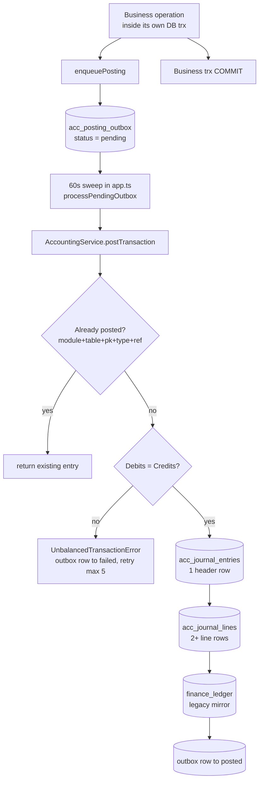
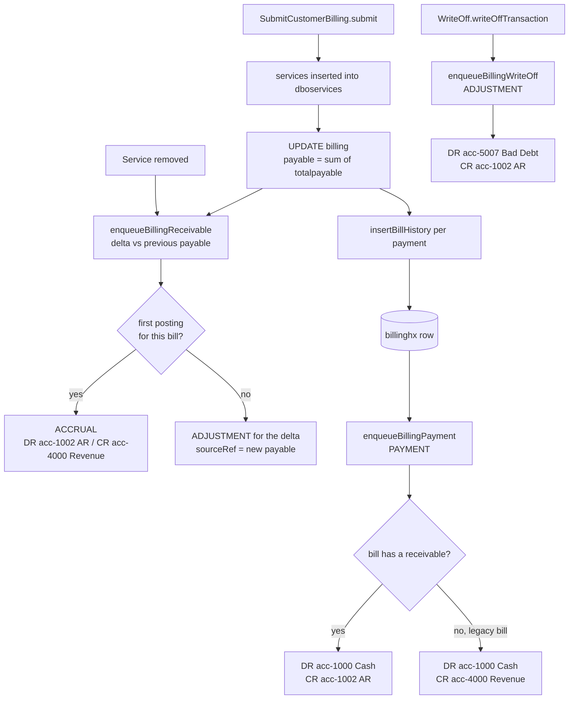
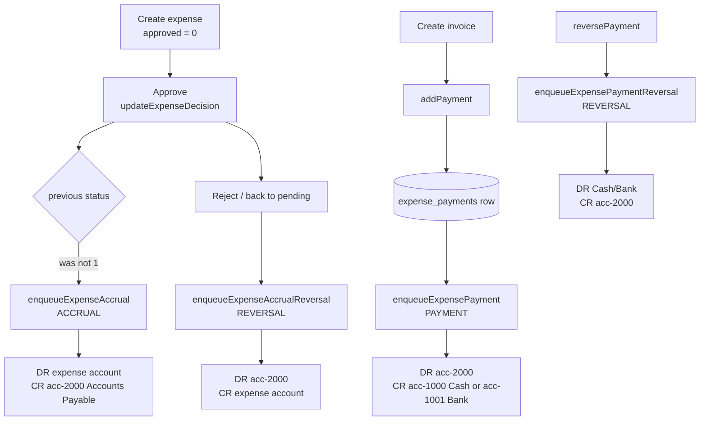
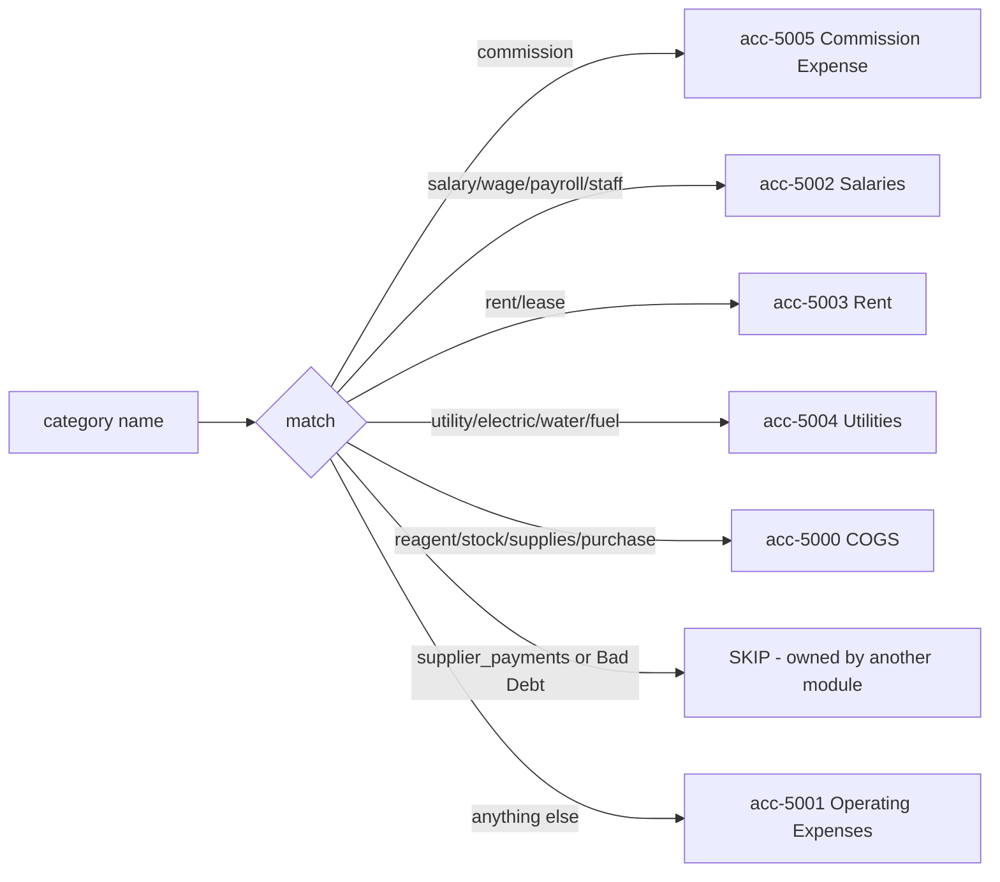
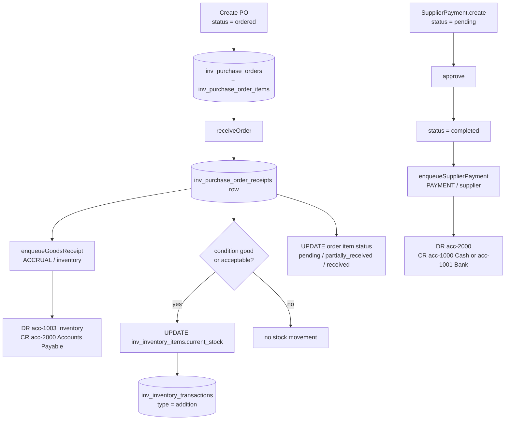
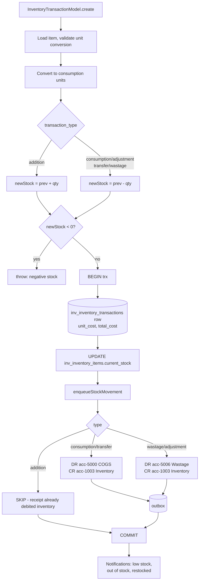
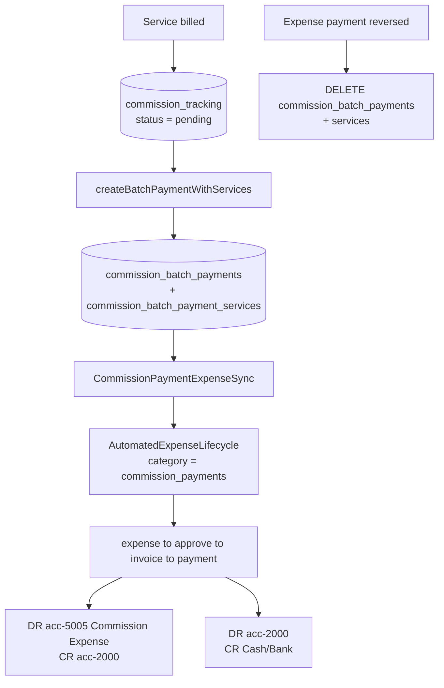
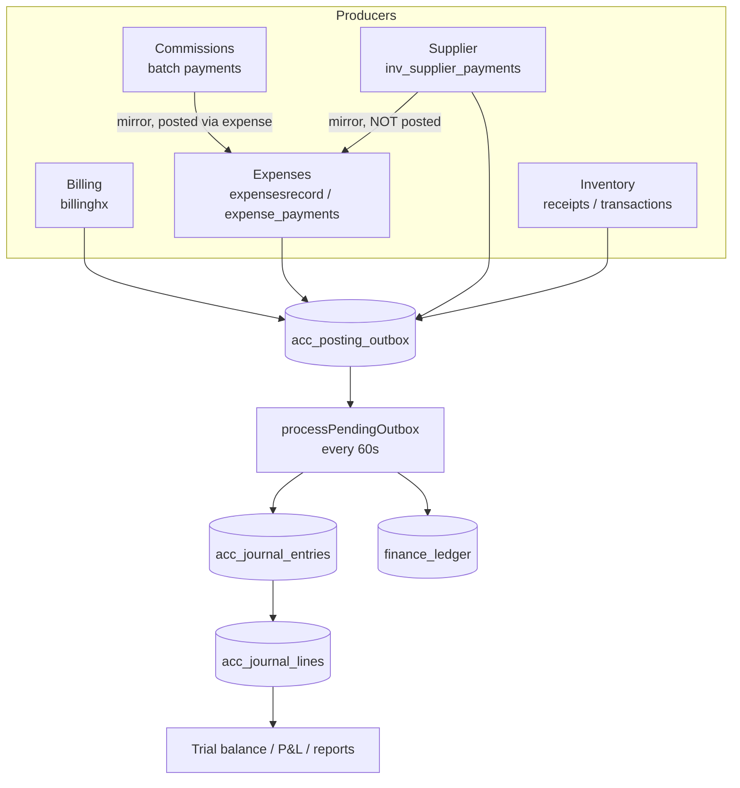

# Accounting Integrations — As-Built Flow Maps

Companion to [accounting-system-flow-map.md](accounting-system-flow-map.md), which describes the
intended design. This document describes what the code **actually does today**, module by module,
and is the reference to use when debugging a missing or duplicated journal entry.

---

## Table map — which tables are live

| Table | Created by | Written by | Status |
|---|---|---|---|
| `acc_accounts` | `accountingSchemaInit.ts` | seeded from `ACCOUNT_CONFIG` | live |
| `acc_journal_entries` | same | `AccountingRepository.createJournalEntry` | live — header, one row per transaction |
| `acc_journal_lines` | same | same | live — **the debit/credit lines** |
| `acc_posting_outbox` | same | `enqueuePosting` | live — the queue |
| `finance_ledger` | `financeLedgerInit.ts` | `FinanceLedgerService.recordEntry` | live — legacy single-entry mirror |
| `acc_journal_entry_lines` | older inventory-side design | **nothing** | dead |

`acc_journal_entry_lines` is the previous flat design (`debit_amount` / `credit_amount` /
`entry_date` on every row, no header table). Its only writer was
`SupplierPayment.createJournalEntries`, which inserted into a table that does not exist in the live
schema and therefore threw on every supplier payment approval. That method has been removed.

**If a bill appears in `acc_journal_entries` but nothing shows in `acc_journal_entry_lines`, that is
expected** — the lines are in `acc_journal_lines`:

```sql
SELECT * FROM acc_journal_lines WHERE journal_entry_id = <id from acc_journal_entries>;
```

### Known gap: dimension columns

`acc_journal_lines` carries `billingid`, `expense_id`, `invoice_id`, `employeeid`, `branchid`. These
were designed for billing and expenses, so **supplier and inventory lines write `NULL` into all of
them**. Those postings link back to their source only through the header:
`source_module` + `source_table` + `source_pk` + `source_ref`.

Consequence: `acc_journal_lines` cannot answer "show all postings for item X or supplier Y" by join.
Adding nullable `item_id` / `supplier_id` columns would close this.

### Known gap: the journal endpoint

`src/controllers/inventory/JournalController.ts` still queries `acc_journal_entry_lines` using
columns (`debit_amount`, `entry_date`, `reference_type`) that do not exist in the live schema. That
endpoint returns nothing and needs rewriting against `acc_journal_entries` joined to
`acc_journal_lines`.

---

## 1. The engine — how any posting reaches the ledger



`enqueuePosting` runs **inside the caller's transaction**; the actual posting runs **outside** it.
That is why a ledger failure can never roll back a bill, an expense or a stock receipt.

The BullMQ "process now" fast path is currently disabled (the bundled Redis 3.x does not meet
BullMQ's >= 5.0.0 requirement), so the 60s sweep is the only delivery path. Worst-case latency
between the business event and the journal entry is 60 seconds.

### Idempotency key

`(source_module, source_table, source_pk, transaction_type, source_ref)`

`source_ref` exists because supplier payments, PO receipts and stock movements use **varchar**
primary keys that cannot fit the integer `source_pk`. For those modules `source_pk` stays `0` and
the string id goes in `source_ref`. Rows from billing and expenses keep `source_ref = ''`.

---

## 2. Billing — accrual basis

Revenue is recognised when the bill is issued, not when cash arrives, so the ledger is accrual
basis on both the revenue and the cost side.



### Cutover for existing bills

Bills issued before receivables existed have no accrual, so crediting AR on their payment would
credit a receivable that was never debited. `hasBillingReceivable` checks the outbox and the
journal for an accrual or adjustment on that bill and falls back to crediting revenue directly.
No date cutoff or config flag is needed — the data decides, and the fallback retires itself as old
bills get settled.

### Adjustments

`enqueueBillingReceivable` posts the **delta** between the previous and current `billing.payable`,
so an addition adjustment or a removed service books only the change. The first posting is an
`ACCRUAL` with an empty `source_ref`; later ones are `ADJUSTMENT`s keyed by the resulting total, so
replaying a given total is a no-op while a further genuine change still posts. Negative deltas flip
both line directions.

### Write-off

A write-off clears the receivable against bad debt expense — no cash moves. The write-off also
creates a mirror expense record through `AutomatedExpenseLifecycle`; that mirror is excluded from
expense postings (category `Bad Debt` is module-owned), because posting it would otherwise
fabricate a cash payment that never happened.

---

## 3. Expenses — full lifecycle



Approval is the accrual point: the liability exists once the expense is approved, independently of
when it is paid.

Because the idempotency key includes the transaction type but not a sequence number, an
approve to reject to approve cycle records **only one** accrual and **one** reversal.

### Expense account selection

Driven by the `dboexpensecategory.category` name:



Payment method decides the credit side: anything matching bank / transfer / cheque / card / momo /
online / eft goes to `acc-1001` Bank, everything else to `acc-1000` Cash.

---

## 4. Supplier and purchase orders — order to payment



**Receiving goods creates the payable; paying the supplier clears it.** No expense account is
touched, because purchased goods are an asset until consumed.

`POST /api/v1/supplier-payments/mark-expense` mirrors a supplier payment into the expenses module
for reporting. That mirror is deliberately **not** posted to the ledger — the category
`supplier_payments` is skipped in `ExpenseAccounting`, otherwise the same cash outflow would be
booked twice and inventory would be debited twice.

Open gap: `PurchaseOrderModel.cancel()` does not reverse stock that was already received, so a
cancelled-after-receipt PO leaves both the stock and its payable in place.

---

## 5. Inventory — a stock transaction



If `total_cost` is null or zero, nothing is posted — the movement is recorded operationally but has
no monetary value to book. Unit cost is resolved FIFO-ish: most recent matching PO receipt first,
then the last transaction with a non-zero `unit_cost`, then the explicit request value.

---

## 6. Commissions



Commissions have **no direct ledger integration by design** — they reach the books through the
expense module, which is why they only needed a dedicated account (`acc-5005`) rather than their own
posting code.

---

## 7. Whole-system map



---

## Chart of accounts

| Code | Name | Type | Normal balance |
|---|---|---|---|
| acc-1000 | Cash | asset | debit |
| acc-1001 | Bank Account | asset | debit |
| acc-1002 | Accounts Receivable | asset | debit |
| acc-1003 | Inventory | asset | debit |
| acc-2000 | Accounts Payable | liability | credit |
| acc-2001 | Loans Payable | liability | credit |
| acc-3000 | Owner's Equity | equity | credit |
| acc-3001 | Retained Earnings | equity | credit |
| acc-4000 | Service Revenue | revenue | credit |
| acc-4001 | Product Sales | revenue | credit |
| acc-5000 | Cost of Goods Sold | expense | debit |
| acc-5001 | Operating Expenses | expense | debit |
| acc-5002 | Salaries Expense | expense | debit |
| acc-5003 | Rent Expense | expense | debit |
| acc-5004 | Utilities Expense | expense | debit |
| acc-5005 | Commission Expense | expense | debit |
| acc-5006 | Inventory Wastage Expense | expense | debit |
| acc-5007 | Bad Debt Expense | expense | debit |

Accounts are seeded from `src/accountingModule/config/accountConfig.ts` on bootstrap. Seeding
inserts only codes that are missing, so adding a new account to the config picks it up on the next
start without a manual migration.

---

## Debugging checklist

1. Is the row in `acc_posting_outbox`? If not, the producer never called `enqueuePosting` — or it
   was skipped (zero amount, module-owned category, `addition` stock movement).
2. Outbox row `status = failed`? Read `last_error`. After 5 attempts the sweep stops retrying.
3. Outbox row `status = pending` and older than a minute? The sweep is not running — check the
   `setInterval` in `app.ts` and whether the process is alive.
4. Row `posted` but you can't find the entry? Look in `acc_journal_lines`, not
   `acc_journal_entry_lines`.
5. Suspect a double posting? Check the idempotency key on the header; two entries with the same
   `source_module`/`source_table`/`source_pk`/`source_ref` and different `transaction_type` are
   correct (e.g. accrual and payment), the same type is not.
