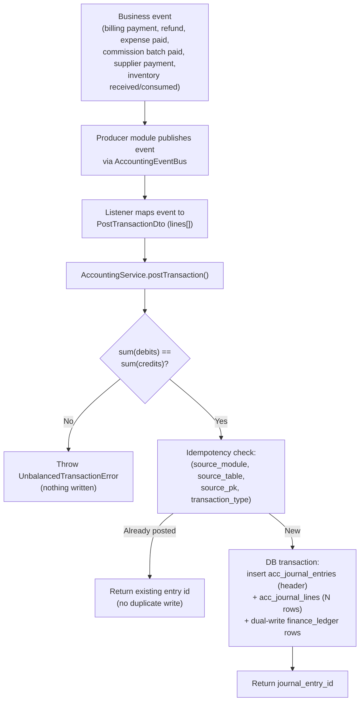
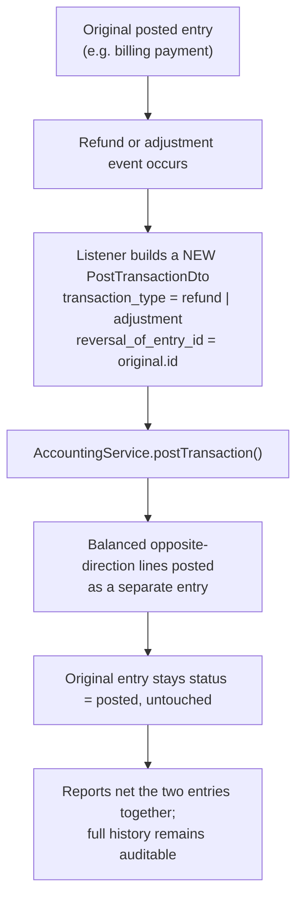
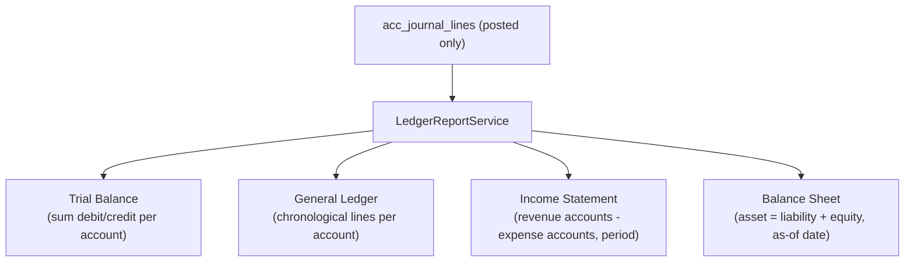
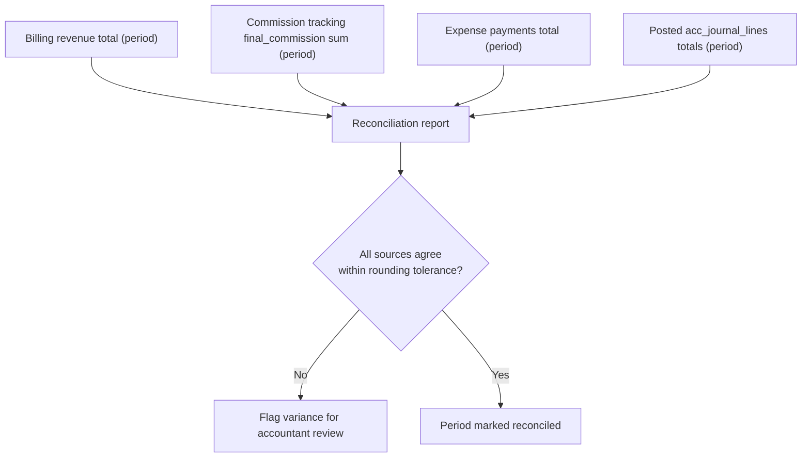

# Accounting Module - Flow Map

Companion to [accounting-system-plan.md](accounting-system-plan.md) and
[accounting-system-prd.md](accounting-system-prd.md). This maps how a business event becomes a
balanced journal entry, and how refunds/adjustments/reversals flow without mutating history.

## Historical migration and optional closing enforcement

Administrators can configure the active branch in Settings > Financial lock. The page shows
the earliest/latest financial activity dates and today's server date (UTC).

- Preview and confirm an inclusive historical date range ending before today. A reason is
  required. One immutable range record protects all dates in the range, including dates with
  no activity; it does not manufacture daily approvals, signed snapshots, or reconciled balances.
- Migrated periods are financially immutable even when overdue-day enforcement is disabled.
  Correct historical errors through current-period linked corrections, not historical edits.
- Activate enforcement separately. The default for a branch without a saved policy is **off**
  with a 48-hour interval. Choose 24 hours, 48 hours, one week (168 hours), or custom whole
  hours from 1 to 8760. The deadline is UTC midnight of the financial activity date plus
  the configured interval, not the time of the first transaction.
- Only migrated ranges and normally finalized dates are excluded from overdue checks.
  Uncovered historical gaps remain eligible: changing the interval or switching enforcement
  off/on does not reset their age. A current-date receipt on an old invoice remains current
  financial activity, subject to existing source-record mutation protections.
- This setting governs laboratory/facility activity, including the shared ledger when pharmacy
  accounting integration is enabled. Independent pharmacy day closing retains its existing policy.

Authenticated, administrator-only APIs (tenant/branch/actor come from the session):

| Method | Endpoint | Purpose |
|---|---|---|
| GET | `/api/v1/financial-day/settings` | Policy, earliest/latest/current dates, historical ranges |
| PUT | `/api/v1/financial-day/settings` | Save `{enabled, graceHours, reason}` with an audit event |
| POST | `/api/v1/financial-day/historical-locks/preview` | Count distinct activity dates for `{startDate, endDate}` |
| POST | `/api/v1/financial-day/historical-locks` | Lock `{startDate, endDate, reason, confirm: true}` without activating enforcement |

Range and audit writes are atomic; identical range retries do not create duplicate locks.
There is no unlock/delete API. Existing finalized-record protections remain independent.
The accounting schema bootstrap creates `financial_lock_settings` and
`financial_historical_locks` and installs database protections for legacy financial writes.
Missing schema is an explicit error, never an automatic enforcement bypass.

## High-level posting flow



## Refund / adjustment / reversal flow



Manual corrections use `POST /api/v1/accounting/journal/:id/reverse`, which is the same code path
as C–E above but initiated by an accountant instead of an automated listener.

## Per-module event mapping

### Billing

```
Payment received (billinghx insert)
  → transaction_type = payment
  → Debit: Cash/Bank (by payment mode)   Credit: Service Revenue

Refund issued
  → transaction_type = refund, reversal_of_entry_id = original payment entry id
  → Debit: Service Revenue (or Refunds/Contra-Revenue)   Credit: Cash/Bank

Post-invoice adjustment (write-off/discount)
  → transaction_type = adjustment
  → Debit: Revenue Adjustments   Credit: Accounts Receivable
```

### Expenses

```
Expense approved & paid
  → transaction_type = payment
  → Debit: Operating Expense (by category)   Credit: Cash/Bank or Accounts Payable
```

### Supplier payments

```
Supplier invoice paid
  → transaction_type = payment
  → Debit: Accounts Payable   Credit: Cash/Bank
```

### Commissions

```
Commission batch marked paid (CommissionBatchPaymentsRepo)
  → transaction_type = payment
  → Debit: Commission Expense   Credit: Cash/Bank or Commission Payable

Waived portion of a batch
  → transaction_type = adjustment
  → Debit: Commission Expense (reduction, credit side)   Credit: n/a (contra entry against original)
```

### Inventory

```
Stock received (purchase order fulfilled)
  → transaction_type = payment or accrual
  → Debit: Inventory (asset)   Credit: Accounts Payable or Cash/Bank

Stock consumed (used in a service)
  → transaction_type = adjustment
  → Debit: Cost of Goods Sold   Credit: Inventory (asset)
```

## Reporting flow



## Reconciliation check (Phase 4)



---

**Last Updated:** August 23, 2026
**Version:** 1.0 (planning — no code implemented yet, see "Current state" in accounting-system-plan.md)
