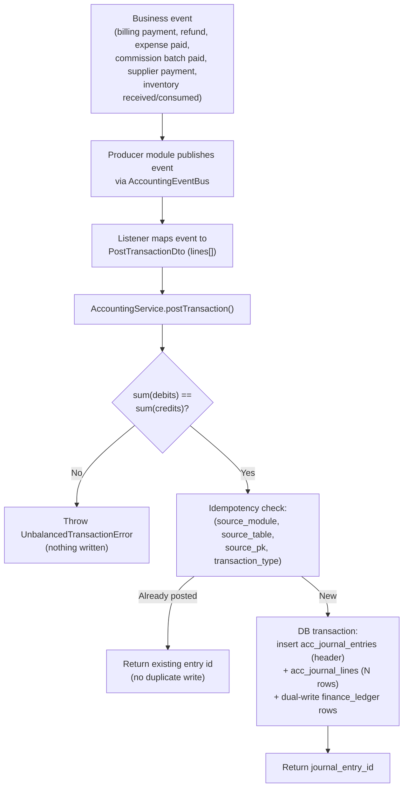
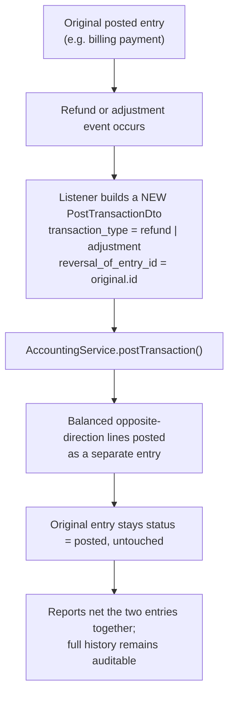
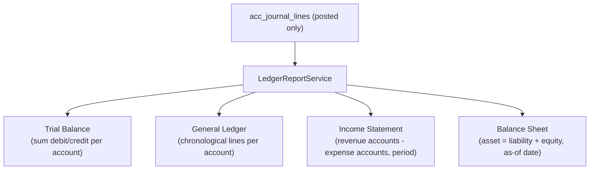
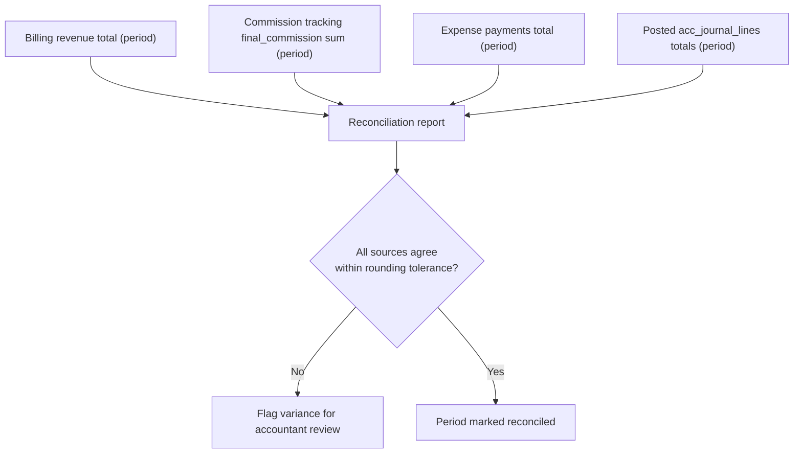

# Accounting Module - Flow Map

Companion to [accounting-system-plan.md](accounting-system-plan.md) and
[accounting-system-prd.md](accounting-system-prd.md). This maps how a business event becomes a
balanced journal entry, and how refunds/adjustments/reversals flow without mutating history.

## Historical migration and optional closing enforcement

Administrators can configure the active branch in Settings > Financial lock. The page shows
the earliest/latest financial activity dates and today's server date (UTC).

- Preview and confirm an inclusive historical date range ending before today. A reason is
  required. One immutable range record protects all dates in the range, including dates with
  no activity; it does not manufacture daily approvals, signed snapshots, or reconciled balances.
- Migrated periods are financially immutable even when overdue-day enforcement is disabled.
  Correct historical errors through current-period linked corrections, not historical edits.
- Activate enforcement separately. The default for a branch without a saved policy is **off**
  with a 48-hour interval. Choose 24 hours, 48 hours, one week (168 hours), or custom whole
  hours from 1 to 8760. The deadline is UTC midnight of the financial activity date plus
  the configured interval, not the time of the first transaction.
- Only migrated ranges and normally finalized dates are excluded from overdue checks.
  Uncovered historical gaps remain eligible: changing the interval or switching enforcement
  off/on does not reset their age. A current-date receipt on an old invoice remains current
  financial activity, subject to existing source-record mutation protections.
- This setting governs laboratory/facility activity, including the shared ledger when pharmacy
  accounting integration is enabled. Independent pharmacy day closing retains its existing policy.

Authenticated, administrator-only APIs (tenant/branch/actor come from the session):

| Method | Endpoint | Purpose |
|---|---|---|
| GET | `/api/v1/financial-day/settings` | Policy, earliest/latest/current dates, historical ranges |
| PUT | `/api/v1/financial-day/settings` | Save `{enabled, graceHours, reason}` with an audit event |
| POST | `/api/v1/financial-day/historical-locks/preview` | Count distinct activity dates for `{startDate, endDate}` |
| POST | `/api/v1/financial-day/historical-locks` | Lock `{startDate, endDate, reason, confirm: true}` without activating enforcement |

Range and audit writes are atomic; identical range retries do not create duplicate locks.
There is no unlock/delete API. Existing finalized-record protections remain independent.
The accounting schema bootstrap creates `financial_lock_settings` and
`financial_historical_locks` and installs database protections for legacy financial writes.
Missing schema is an explicit error, never an automatic enforcement bypass.

## High-level posting flow



## Refund / adjustment / reversal flow



Manual corrections use `POST /api/v1/accounting/journal/:id/reverse`, which is the same code path
as C–E above but initiated by an accountant instead of an automated listener.

## Per-module event mapping

### Billing

#### National Health Insurance Scheme (NHIS)

Laboratory bills whose live services are all NHIS are owed by **NHIS**, not by the
patient. Patient charges must be separate bills. Mixed bills are explicitly flagged
for review rather than assigning their entire balance to NHIS. Existing bill-linked
subledger history is attributed in reports without rewriting finalized records or
posting the same revenue again.

```
NHIS bill issued
  -> Debit: Accounts Receivable   Credit: Service Revenue (and output tax, if applicable)
  -> AR party: National Health Insurance Scheme (NHIS)

NHIA remittance allocated to specific bills
  -> Debit: selected Cash/Bank   Credit: Accounts Receivable

Explicit final tariff/revenue adjustment
  -> Debit: Service Revenue (and proportional output tax)   Credit: Accounts Receivable

Explicit authorized uncollectible-debt write-off
  -> Debit: Bad Debt Expense   Credit: Accounts Receivable
```

Rejected, queried or merely unpaid claims are **not automatically written off**.
Choose the adjustment type and supply the external reference and reason. A tariff
adjustment and a bad-debt write-off are distinct accounting events.

Authenticated accounting APIs use the tenant, branch and employee from the session:

| Method | Endpoint | Purpose |
|---|---|---|
| GET | `/api/v1/accounting/nhis/receivables?from=2026-01-01&to=2026-04-30` | Current recoveries/balances for the selected **bill/service period** |
| GET | `/api/v1/accounting/nhis/cash-receipts?from=2026-11-01&to=2026-11-30` | Cash received/refunded/reversed in the selected **receipt period**, including older bills |
| GET | `/api/v1/accounting/nhis/events` | Remittance, adjustment and reversal audit trail, including bill allocations |
| POST | `/api/v1/accounting/nhis/receipts` | Record a verified remittance and exact bill allocations |
| POST | `/api/v1/accounting/nhis/adjustments` | Explicit `revenue_adjustment` or `write_off` |
| POST | `/api/v1/accounting/nhis/events/:id/reversal` | Append an exact linked reversal; never delete the original |

Reports support `page` and `count`; totals cover the entire filtered result, not just
the page. The receivables report is a **current balance report**, not a historical
as-of snapshot. `expected` is the recognized current bill payable, not a new estimate
of NHIA tariff eligibility or an externally approved claim value. It reports received,
revenue adjustments, write-offs and outstanding separately. `excludedMixedBills`
identifies bills requiring separation/review. `unverifiedLegacyReceipts` identifies
differences between old bill payment totals and available receipt history; those
differences are not manufactured as cash receipts.
`reconciliationDifference` flags an inconsistent original bill equation
(`payable - paid - writeoff - outstanding`) instead of silently balancing it.
The general receivables report also distinguishes `nhisReceivedAmount` (net cash
receipts) from `nhisSettledAmount` (all net debt reductions). `payerPaid` includes
only the former; tariff adjustments and write-offs must never appear as money received.
The legacy Cash Collection lookup exposes the same payer classification and projected
balances, plus service-level NHIS/source metadata. Its `headerOutstanding` remains
the original invoice balance; its displayed `outstanding`/`payerOutstanding` subtract
linked NHIS settlements. Fully settled NHIS bills are omitted from its pending list.
NHIS/mixed payer metadata lets the frontend route settlement to the NHIS workspace
or require payer separation instead of presenting these balances as patient cash debt.

Receipt example (amounts are Ghana cedis, at most two decimal places):

```json
{
  "requestKey": "nhis-remittance-2026-0001",
  "reference": "NHIA remittance reference",
  "reason": "Verified against bank statement",
  "date": "2026-11-04",
  "amount": 500000,
  "paymentAccountCode": "acc-1001",
  "allocations": [
    { "billingId": 42, "amount": 250000 },
    { "billingId": 43, "amount": 250000 }
  ]
}
```

For an adjustment, omit `paymentAccountCode` and add
`"kind": "revenue_adjustment"` or `"kind": "write_off"`. A reversal accepts only
`requestKey`, `reference`, `reason` and `date`. Receipts require
`accounting.journal.post`, adjustments require `accounting.journal.approve`, and
reversals require `accounting.financial_correction.execute`, checked against the
**full event amount** and the active branch.

Events and signed allocations are append-only, idempotent by request key, and posted
atomically with the subledger and accounting outbox. An unchanged retry returns the
same event; reusing a key for different input is rejected. Concurrent allocations
cannot exceed the remaining receivable. Collection requires an existing accounting
accrual. A branch cannot record the same external reference twice for the same event
type, even with a new request key. Resolve historical coverage/opening balances
rather than silently booking
new revenue when collecting old debt.

Current-period remittances may settle old finalized bills without modifying those
bills. The accounting receivable balance is projected from the original outstanding
amount less linked NHIS allocations. Once linked NHIS events exist, legacy bill edits,
refunds and collections are blocked to prevent using the stale original balance;
use this NHIS workflow and linked reversals. The original bill/service records remain
unchanged. NHIS receipt/adjustment dates participate in financial-day readiness,
signed snapshots and finalization manifests. Closed/locked posting periods and
finalized/historically locked posting dates remain protected.

The accounting bootstrap installs `acc_nhis_events`, `acc_nhis_allocations` and MySQL
immutability triggers. Restart/bootstrap the updated backend before using these APIs.
Server-authoritative proportional service-period remittances, later final
adjustment-only decisions, bounded allocation audit and atomic settlement reversals
are documented in [NHIS period settlement API](nhis-period-settlements-api.md).
They append `acc_nhis_period_settlements` metadata; settling a service cohort does
not close or reopen its historic accounting period.
This is laboratory accounting; the independent pharmacy NHIS register is unchanged,
and no live NHIA submission or automatic claim adjudication is introduced.

```
Payment received (billinghx insert)
  → transaction_type = payment
  → Debit: Cash/Bank (by payment mode)   Credit: Service Revenue

Refund issued
  → transaction_type = refund, reversal_of_entry_id = original payment entry id
  → Debit: Service Revenue (or Refunds/Contra-Revenue)   Credit: Cash/Bank

Post-invoice adjustment (write-off/discount)
  → transaction_type = adjustment
  → Debit: Revenue Adjustments   Credit: Accounts Receivable
```

### Expenses

```
Expense approved & paid
  → transaction_type = payment
  → Debit: Operating Expense (by category)   Credit: Cash/Bank or Accounts Payable
```

### Supplier payments

```
Supplier invoice paid
  → transaction_type = payment
  → Debit: Accounts Payable   Credit: Cash/Bank
```

### Commissions

```
Commission batch marked paid (CommissionBatchPaymentsRepo)
  → transaction_type = payment
  → Debit: Commission Expense   Credit: Cash/Bank or Commission Payable

Waived portion of a batch
  → transaction_type = adjustment
  → Debit: Commission Expense (reduction, credit side)   Credit: n/a (contra entry against original)
```

### Inventory

```
Stock received (purchase order fulfilled)
  → transaction_type = payment or accrual
  → Debit: Inventory (asset)   Credit: Accounts Payable or Cash/Bank

Stock consumed (used in a service)
  → transaction_type = adjustment
  → Debit: Cost of Goods Sold   Credit: Inventory (asset)
```

## Reporting flow



## Reconciliation check (Phase 4)



---

**Last Updated:** August 23, 2026
**Version:** 1.0 (planning — no code implemented yet, see "Current state" in accounting-system-plan.md)
