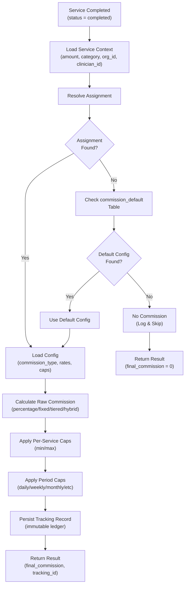

# Commission Engine - Complete Flow Map

## Overview

This document maps the complete logic flow of the commission engine, including the resolution algorithm, calculation steps, and fallback to the `commission_default` table.

---

## High-Level Flow Diagram



---

## Detailed Step-by-Step Flow

### Phase 1: Service Completion & Context Loading

```
INPUT: Service ID, Service Amount, Service Category, Organization ID, Clinician ID, Completion Date

↓

STEP 1: Load Service Context
├─ Query service by ID
├─ Get: amount, category, organization_id, clinician_id
└─ Validate service exists and is completed

OUTPUT: Service Context Object
```

### Phase 2: Assignment Resolution (With Default Fallback)

```
STEP 2: Resolve Applicable Assignment

┌─────────────────────────────────────────────────────────────┐
│ RESOLUTION ALGORITHM (Priority Order)                       │
├─────────────────────────────────────────────────────────────┤
│                                                              │
│ Level 1: CLINICIAN-SPECIFIC ASSIGNMENT                      │
│ ├─ IF clinician_id exists:                                  │
│ │  └─ Query commission_assignments WHERE:                   │
│ │     ├─ scope_type = 'clinician'                           │
│ │     ├─ scope_id = clinician_id                            │
│ │     ├─ service_id = service_id (exact match) OR           │
│ │     ├─ service_category = service_category OR             │
│ │     ├─ service_id & service_category both NULL (global)   │
│ │     └─ is_active = TRUE & dates valid                     │
│ │  └─ IF FOUND → Return (Priority 100-199)                  │
│ │                                                             │
│ Level 2: ORGANIZATION-SPECIFIC ASSIGNMENT                   │
│ ├─ Query commission_assignments WHERE:                      │
│ │  ├─ scope_type = 'organization'                           │
│ │  ├─ scope_id = organization_id                            │
│ │  ├─ service_id or service_category or global              │
│ │  └─ is_active = TRUE & dates valid                        │
│ │  └─ IF FOUND → Return (Priority 50-99)                    │
│                                                              │
│ Level 3: SYSTEM-WIDE ASSIGNMENT                             │
│ ├─ Query commission_assignments WHERE:                      │
│ │  ├─ scope_type = 'system'                                 │
│ │  ├─ scope_id IS NULL                                      │
│ │  └─ is_active = TRUE & dates valid                        │
│ │  └─ IF FOUND → Return (Priority 1-49)                     │
│                                                              │
│ Level 4: DEFAULT FALLBACK ⭐                                │
│ ├─ IF NO ASSIGNMENT FOUND IN LEVELS 1-3:                    │
│ │  ├─ Query commission_default WHERE:                       │
│ │  │  ├─ recipient_type = 'clinician' OR 'organization'     │
│ │  │  ├─ recipient_id = clinician_id OR organization_id     │
│ │  │  └─ is_active = TRUE                                   │
│ │  ├─ IF FOUND → Load config from default                   │
│ │  └─ IF NOT FOUND → No Commission (Log gap & exit)         │
│                                                              │
└─────────────────────────────────────────────────────────────┘

OUTPUT: Assignment + Commission Config (or NULL)
```

### Phase 3: Commission Configuration

```
STEP 3: Retrieve Commission Config

IF Assignment Found:
├─ Load commission_configs WHERE id = commission_config_id
├─ Validate config is active & effective on completion_date
└─ Extract: commission_type, rates, caps, period_cap_reset

IF Default Used:
├─ Load commission_configs from commission_default reference
└─ Extract same fields

OUTPUT: CommissionConfig Object
{
  id, name, commission_type (percentage|fixed|tiered|hybrid),
  percentage_rate, fixed_component, min_commission, max_commission,
  period_cap, period_cap_reset (daily|weekly|monthly|quarterly|yearly)
}
```

### Phase 4: Raw Commission Calculation

```
STEP 4: Calculate Raw Commission Based on Type

┌──────────────────────────────────────────────────────────┐
│ COMMISSION_TYPE: PERCENTAGE                              │
├──────────────────────────────────────────────────────────┤
│ Formula: amount × (percentage_rate ÷ 100)                │
│ Example: 150 GHS × (10% ÷ 100) = 15 GHS                 │
│ Precision: Decimal.js (28 digits)                        │
└──────────────────────────────────────────────────────────┘

┌──────────────────────────────────────────────────────────┐
│ COMMISSION_TYPE: FIXED                                   │
├──────────────────────────────────────────────────────────┤
│ Formula: fixed_component (constant)                       │
│ Example: fixed_component = 10 GHS → Commission = 10 GHS  │
│ (Service amount irrelevant)                              │
└──────────────────────────────────────────────────────────┘

┌──────────────────────────────────────────────────────────┐
│ COMMISSION_TYPE: TIERED                                  │
├──────────────────────────────────────────────────────────┤
│ 1. Query commission_tiers WHERE:                          │
│    ├─ commission_config_id = config.id                   │
│    ├─ min_amount_inclusive ≤ service_amount              │
│    └─ (max_amount_exclusive IS NULL OR                   │
│       max_amount_exclusive > service_amount)             │
│                                                           │
│ 2. IF Tier Found:                                         │
│    ├─ IF tier.type = 'percentage':                        │
│    │  └─ amount × (tier_value ÷ 100)                     │
│    └─ IF tier.type = 'fixed':                             │
│       └─ tier_value (constant)                            │
│                                                           │
│ 3. IF No Tier Matches: THROW TierNotFoundError            │
│                                                           │
│ Example:                                                  │
│  Tiers: [0-50→5], [50-100→10], [100+→20]                │
│  Amount: 150 GHS → Matches [100+→20] → 20 GHS            │
└──────────────────────────────────────────────────────────┘

┌──────────────────────────────────────────────────────────┐
│ COMMISSION_TYPE: HYBRID                                  │
├──────────────────────────────────────────────────────────┤
│ Formula: (amount × (percentage ÷ 100)) + fixed_component │
│ Example: (100 × (10 ÷ 100)) + 5 = 10 + 5 = 15 GHS      │
│ Combines percentage component with fixed base            │
└──────────────────────────────────────────────────────────┘

OUTPUT: raw_commission (before caps)
```

### Phase 5: Apply Per-Service Caps (Min/Max)

```
STEP 5: Apply Caps

INPUT: raw_commission, config.min_commission, config.max_commission

┌──────────────────────────────────────────────────────────┐
│ MINIMUM CAP                                              │
├──────────────────────────────────────────────────────────┤
│ IF config.min_commission IS NOT NULL:                    │
│   IF raw_commission < min_commission:                    │
│     ├─ min_adjustment = min_commission - raw_commission │
│     ├─ raw_commission = min_commission                   │
│     └─ Track: min_cap_adjustment value                   │
│   ELSE:                                                   │
│     └─ min_cap_adjustment = 0                            │
│                                                           │
│ Example:                                                  │
│  raw = 3 GHS, min = 5 GHS                               │
│  → adjustment = 2 GHS, final = 5 GHS                    │
└──────────────────────────────────────────────────────────┘

┌──────────────────────────────────────────────────────────┐
│ MAXIMUM CAP                                              │
├──────────────────────────────────────────────────────────┤
│ IF config.max_commission IS NOT NULL:                    │
│   IF raw_commission > max_commission:                    │
│     ├─ max_adjustment = raw_commission - max_commission  │
│     ├─ raw_commission = max_commission                   │
│     └─ Track: max_cap_adjustment value                   │
│   ELSE:                                                   │
│     └─ max_adjustment = 0                                │
│                                                           │
│ Example:                                                  │
│  raw = 150 GHS, max = 100 GHS                           │
│  → adjustment = 50 GHS, final = 100 GHS                 │
└──────────────────────────────────────────────────────────┘

OUTPUT: capped_commission, min_cap_adjustment, max_cap_adjustment
```

### Phase 6: Apply Period Caps (Time-Based)

```
STEP 6: Apply Period Caps (If Configured)

INPUT: capped_commission, config.period_cap, config.period_cap_reset

┌──────────────────────────────────────────────────────────┐
│ 6A. DETERMINE PERIOD REFERENCE DATE                      │
├──────────────────────────────────────────────────────────┤
│ Based on completion_date and period_cap_reset:           │
│                                                           │
│ DAILY:      completion_date itself (2024-06-15)         │
│ WEEKLY:     Monday of the week (2024-06-10)             │
│ MONTHLY:    First day of month (2024-06-01)             │
│ QUARTERLY:  First day of quarter (2024-04-01)           │
│ YEARLY:     Jan 1 of year (2024-01-01)                  │
│                                                           │
│ Example: 2024-06-15 with MONTHLY → period_ref = 2024-06-01
└──────────────────────────────────────────────────────────┘

┌──────────────────────────────────────────────────────────┐
│ 6B. QUERY EXISTING PERIOD TOTAL                          │
├──────────────────────────────────────────────────────────┤
│ SELECT SUM(final_commission) FROM commission_tracking    │
│ WHERE:                                                    │
│   ├─ recipient_type = clinician OR organization          │
│   ├─ recipient_id = recipient_id                         │
│   ├─ cap_period_reference = period_ref                   │
│   └─ status IN ('pending', 'approved', 'paid')           │
│                                                           │
│ Example: Current period total = 950 GHS                 │
└──────────────────────────────────────────────────────────┘

┌──────────────────────────────────────────────────────────┐
│ 6C. CHECK AGAINST PERIOD CAP                             │
├──────────────────────────────────────────────────────────┤
│ proposed_total = period_total + capped_commission        │
│                                                           │
│ IF proposed_total > period_cap:                          │
│   ├─ period_adjustment = proposed_total - period_cap     │
│   ├─ final_commission = capped_commission - adjustment   │
│   └─ final_commission = MAX(0, final_commission)         │
│ ELSE:                                                     │
│   ├─ period_adjustment = 0                               │
│   └─ final_commission = capped_commission                │
│                                                           │
│ Example:                                                  │
│  period_total = 950 GHS, period_cap = 1000 GHS          │
│  capped_commission = 150 GHS                             │
│  proposed = 950 + 150 = 1100 GHS (exceeds cap by 100)    │
│  → period_adjustment = 100                               │
│  → final_commission = 150 - 100 = 50 GHS                 │
└──────────────────────────────────────────────────────────┘

OUTPUT: final_commission, period_cap_adjustment, period_reference_date
```

### Phase 7: Persist to Tracking (Immutable Ledger)

```
STEP 7: Insert Into commission_tracking

INSERT INTO commission_tracking (
  service_id,                   → From input
  service_amount,              → From input (snapshot)
  commission_type,             → From config
  percentage_rate_applied,     → From config (if applicable)
  fixed_amount_applied,        → From config (if applicable)
  tier_id,                     → From matched tier (if tiered)
  commission_due,              → raw_commission (before caps)
  min_cap_adjustment,          → From Step 5
  max_cap_adjustment,          → From Step 5
  period_cap_adjustment,       → From Step 6
  final_commission,            → After all caps
  config_id,                   → From config
  assignment_id,               → From assignment (or default)
  recipient_type,              → 'clinician' or 'organization'
  recipient_id,                → clinician_id or organization_id
  cap_period_reference,        → From Step 6a (if period cap)
  calculated_at,               → Current timestamp
  currency,                    → 'GHS'
  status,                      → 'pending'
  created_at,                  → Current timestamp
  updated_at                   → Current timestamp
)

RULES:
├─ NEVER UPDATE existing records
├─ NEVER DELETE existing records
├─ All records are immutable
└─ Full audit trail preserved

OUTPUT: tracking_id (primary key)
```

### Phase 8: Return Result

```
STEP 8: Return CommissionCalculationResult

SUCCESS Case:
{
  final_commission: 50.00,      ← Amount after all caps
  tracking_id: 1234,             ← For reference
  reason: 'SUCCESS'              ← Status code
}

NO_CONFIG Case (No assignment + No default):
{
  final_commission: 0,
  tracking_id: undefined,
  reason: 'NO_CONFIG'            ← Admin must configure
}

ERROR Case (Tier not found, etc):
{
  final_commission: 0,
  tracking_id: undefined,
  reason: 'ERROR',
  error: 'Tier not found for config 5 with amount 150'
}
```

---

## Commission Default Table (Fallback)

The `commission_default` table provides fallback configuration when no explicit assignment matches.

### Schema

```sql
CREATE TABLE commission_default (
  id INT AUTO_INCREMENT PRIMARY KEY,
  recipient_type ENUM('clinician', 'organization') NOT NULL,
  recipient_id INT NOT NULL,
  commission_config_id INT NOT NULL,
  is_active BOOLEAN DEFAULT TRUE,
  created_at TIMESTAMP DEFAULT CURRENT_TIMESTAMP,

  FOREIGN KEY (commission_config_id) REFERENCES commission_configs(id),
  UNIQUE KEY uk_recipient (recipient_type, recipient_id)
);
```

### Usage Example

**Scenario:** No specific assignment found for Dr. Adjei (clinician 42)

1. Check `commission_assignments` → No match
2. Check `commission_default` WHERE recipient_type='clinician' AND recipient_id=42
3. If found → Use referenced config_id
4. If not found → No commission (0 GHS)

### Flow with Default

```
┌─────────────────────────────────────┐
│ Service Completed (clinician 42)    │
└─────────────────────────────────────┘
            ↓
┌─────────────────────────────────────┐
│ Check commission_assignments        │
│ (clinician/org/system)              │
└─────────────────────────────────────┘
            ↓
    ❌ No Match Found
            ↓
┌─────────────────────────────────────┐
│ Check commission_default            │
│ WHERE recipient_type='clinician'    │
│   AND recipient_id=42               │
└─────────────────────────────────────┘
            ↓
    ✅ Found Default Config (ID: 7)
            ↓
┌─────────────────────────────────────┐
│ Load commission_configs ID=7        │
│ (e.g., "Dr. Adjei - 15% Rate")     │
└─────────────────────────────────────┘
            ↓
┌─────────────────────────────────────┐
│ Calculate Commission with Config 7  │
│ Result: 22.50 GHS                  │
└─────────────────────────────────────┘
```

---

## Complete End-to-End Example

### Setup

```
Organization: Yendi Hospital (ID: 5)
Clinician: Dr. Kwame Asante (ID: 42)
Service: Malaria RDT
  - Service ID: 101
  - Amount: 50 GHS
  - Category: Microbiology
  - Completion Date: 2024-06-15

commission_configs:
  - Config 1: "Yendi Org 10% Percentage" (percentage_rate=10)
  - Config 7: "Dr. Adjei Default 15%" (percentage_rate=15)

commission_assignments:
  - Assignment A: scope_type='organization', scope_id=5, config_id=1, priority=50, active

commission_default:
  - Default: recipient_type='clinician', recipient_id=42, config_id=7
```

### Execution Flow

```
1️⃣  Input received:
    ├─ service_id: 101
    ├─ service_amount: 50
    ├─ service_category: Microbiology
    ├─ organization_id: 5
    ├─ clinician_id: 42
    └─ completion_date: 2024-06-15

2️⃣  Resolve Assignment:
    ├─ Check clinician 42 assignments → None
    ├─ Check organization 5 assignments → Found Assignment A (config_id=1)
    └─ Use: Config 1 (10% percentage)

3️⃣  Calculate Raw Commission:
    ├─ Type: percentage
    ├─ Formula: 50 × (10 ÷ 100)
    └─ Result: 5 GHS

4️⃣  Apply Caps:
    ├─ Min cap: None
    ├─ Max cap: None
    └─ Capped: 5 GHS

5️⃣  Apply Period Cap:
    ├─ No period cap configured
    └─ Final: 5 GHS

6️⃣  Persist Tracking:
    ├─ Insert: service_id=101, final_commission=5
    ├─ config_id=1 (from organization)
    └─ recipient_type='organization', recipient_id=5

7️⃣  Return:
    ├─ final_commission: 5.00 GHS
    ├─ tracking_id: 1001
    └─ reason: 'SUCCESS'
```

---

## Alternative Example: Using Default

**Same setup, but NO organization assignment:**

```
commission_assignments: (EMPTY - no assignments)
commission_default: (Has clinician 42 → Config 7)

Flow:
1️⃣  Input: clinician_id=42, organization_id=5, amount=50

2️⃣  Resolve Assignment:
    ├─ Check clinician 42 → No assignment
    ├─ Check organization 5 → No assignment
    ├─ Check system-wide → No assignment
    └─ Check commission_default → Found! config_id=7

3️⃣  Load Config 7 (15% percentage)

4️⃣  Calculate: 50 × (15 ÷ 100) = 7.50 GHS

5️⃣  Final: 7.50 GHS (from default, not assignment)

Output:
{
  final_commission: 7.50,
  tracking_id: 1002,
  reason: 'SUCCESS'  ← Same success code, but via default
}
```

---

## Error Handling Flow

```
┌─────────────────────────────────────────────────────────┐
│ Service Completed                                       │
└─────────────────────────────────────────────────────────┘
            ↓
        Try to Resolve:
    ├─ Clinician assignment? NO
    ├─ Organization assignment? NO
    ├─ System assignment? NO
    └─ Default config? NO
            ↓
┌─────────────────────────────────────────────────────────┐
│ ❌ NO CONFIG FOUND                                      │
├─────────────────────────────────────────────────────────┤
│ Result: {                                               │
│   final_commission: 0,                                  │
│   tracking_id: undefined,                               │
│   reason: 'NO_CONFIG'                                   │
│ }                                                       │
│                                                         │
│ Action: Log warning for admin review                    │
│ Admin must create assignment or default                 │
└─────────────────────────────────────────────────────────┘

OTHER ERRORS:

Tier Not Found (Tiered config):
  → Throw TierNotFoundError
  → Result: { reason: 'ERROR', error: message }

Invalid Config:
  → Throw InvalidCommissionConfigError
  → Result: { reason: 'ERROR', error: message }

Database Error:
  → Throw DatabaseError
  → Result: { reason: 'ERROR', error: message }
```

---

## Resolution Priority Matrix

| Scope            | Priority | Matches                   | Applied When                     |
| ---------------- | -------- | ------------------------- | -------------------------------- |
| **Clinician**    | 100-199  | Clinician ID exact        | Individual override needed       |
| **Organization** | 50-99    | Organization ID exact     | Group-level rule                 |
| **System**       | 1-49     | None (global)             | Organization-wide fallback       |
| **Default**      | N/A      | commission_default lookup | No explicit assignment           |
| **None**         | N/A      | No match anywhere         | Configuration gap (0 commission) |

---

## Key Flow Characteristics

✅ **Deterministic** - Same inputs always produce same output  
✅ **Auditable** - Every calculation tracked with full details  
✅ **Immutable** - No updates/deletes on tracking records  
✅ **Fail-Safe** - Default table catches unhandled cases  
✅ **Traceable** - Full path from service → config → commission recorded  
✅ **Precise** - Decimal.js for accurate GHS calculations  
✅ **Time-Aware** - Period caps adapt to daily/weekly/monthly/quarterly/yearly

---

## Debugging Tips

1. **Commission is 0?**
   - Check if assignment was found (log shows which scope)
   - Check if default exists for recipient
   - Check if config is active on completion_date

2. **Unexpected amount?**
   - Check raw vs final (caps applied?)
   - Check period_cap_adjustment in tracking record
   - Verify tier boundaries if tiered config

3. **No tracking record created?**
   - Check if assignment/default resolved
   - Check TierNotFoundError logs
   - Check config validation errors

4. **Wrong recipient type?**
   - If clinician_id is null → recipient becomes organization
   - Check clinician_id wasn't accidentally set to 0

---

**Last Updated:** May 6, 2026  
**Version:** 1.0  
**Status:** Production Ready
